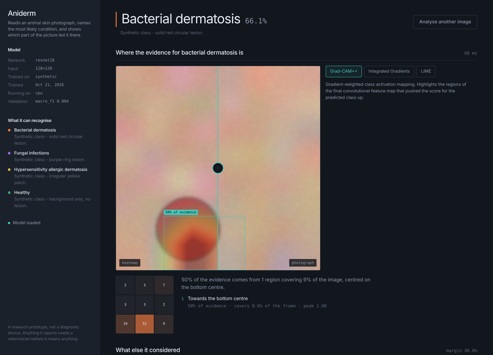

# Aniderm — animal skin disease classification with explainable AI

Classifies a photograph of animal skin into a dermatological category, then shows which
parts of the image produced that answer and measures whether that explanation can be
trusted.

Three explainers ship: Grad-CAM++ (default), Integrated Gradients and LIME. Each map is
scored by a deletion/insertion test against a random control, so an explanation that
merely looks convincing is reported as such.



*Shown running against the synthetic stand-in dataset described below, which is why
the class descriptions read "solid red circular lesion". With the real dataset the
layout is identical and the descriptions are the clinical ones.*

---

## Quick start

Python 3.10 or newer, Node 18 or newer.

```bash
git clone <your-repo-url> animal-skin-disease-xai
cd animal-skin-disease-xai

python -m venv .venv
source .venv/bin/activate          # Windows: .venv\Scripts\activate

# CUDA first if you have an NVIDIA GPU — check the right index URL for your driver
# at https://pytorch.org/get-started/locally/
pip install torch torchvision --index-url https://download.pytorch.org/whl/cu124
pip install -r requirements.txt
```

### See it working in about ten minutes, without any download

```bash
python scripts/make_synthetic_dataset.py --output data/raw/synthetic --per-class 60
python scripts/prepare_data.py --dataset configs/datasets/synthetic.yaml
python scripts/train.py --dataset configs/datasets/synthetic.yaml \
    --backbone resnet18 --no-pretrained --image-size 128 \
    --epochs-head 2 --epochs-finetune 8
```

The synthetic images are coloured blobs on noisy backgrounds. They exist to prove the
pipeline runs end to end and to give the tests something deterministic. Any accuracy
measured on them means nothing about dermatology.

### The real thing

```bash
pip install kaggle
# Kaggle → Settings → Create New Token, save kaggle.json to ~/.kaggle/kaggle.json
chmod 600 ~/.kaggle/kaggle.json

python scripts/download_dataset.py
python scripts/prepare_data.py --inspect-only    # check what actually landed on disk
python scripts/prepare_data.py
python scripts/train.py
python scripts/evaluate.py --save-errors
```

`--inspect-only` prints the directory tree and per-class counts before anything is
committed to. Run it. Public datasets get re-uploaded with different folder names, and
finding that out before training beats finding it out after.

### Run the application

```bash
cd frontend && npm install && npm run build && cd ..
uvicorn api.main:app --reload
```

Open http://127.0.0.1:8000. API docs are at `/docs`.

For frontend work, run the two servers separately:

```bash
uvicorn api.main:app --reload        # terminal 1
cd frontend && npm run dev           # terminal 2, then open http://localhost:5173
```

The Vite dev server proxies `/api` to uvicorn, so there is no CORS to configure.

---

## What the interface shows

**The reading.** The most likely condition, its probability, and how close the runner-up
came. When the top probability falls below the configured threshold, when two classes are
within a few points of each other, or when the distribution is near-uniform, that is
stated in the response rather than hidden behind a confident-looking percentage.

**Where it looked.** A heatmap you drag against the original photograph, the strongest
region boxed, and a 3×3 grid giving each ninth of the frame its share of the evidence.
That grid is the quickest way to catch a model that has learned the background instead of
the lesion.

**Whether to believe it.** The highlighted pixels are removed from the image and added
back to a blurred reference, and the predicted probability is tracked through both. A
random pixel ranking is scored alongside. If the heatmap barely beats random, the verdict
says so.

Any class can be explained, not only the predicted one. Asking where the evidence for
*healthy* would have been is often how you notice the model is not separating two classes
at all.

---

## Commands

| | |
|---|---|
| `python scripts/download_dataset.py` | fetch and extract from Kaggle |
| `python scripts/prepare_data.py --inspect-only` | print the layout and per-class counts |
| `python scripts/prepare_data.py` | build the train/val/test manifest |
| `python scripts/train.py` | two-stage transfer learning |
| `python scripts/train.py --crossval` | k-fold, reports mean ± std |
| `python scripts/evaluate.py --save-errors` | metrics, confusion matrix, misclassified images |
| `python scripts/explain_image.py photo.jpg` | classify and explain one file |
| `uvicorn api.main:app --reload` | serve the API and the built frontend |
| `pytest` | 131 tests, no dataset or network needed |

Useful flags:

```bash
python scripts/train.py --backbone efficientnet_b3 --image-size 300 --batch-size 16
python scripts/train.py --device cpu --no-amp --num-workers 0
python scripts/explain_image.py photo.jpg --methods gradcam_pp lime --target-class healthy
python scripts/evaluate.py --split val --checkpoint artifacts/checkpoints/fold3.pt
```

---

## Configuration

Everything lives in `configs/default.yaml` — backbone, image size, augmentation, learning
rates, XAI parameters, serving. Nothing under `src/aniderm/` hardcodes a class name or a
class count, so switching to a different dataset is one line:

```yaml
dataset_config: configs/datasets/dogs_skin_broad.yaml
```

followed by `python scripts/prepare_data.py --force`.

The default backbone is `efficientnet_b0` at 224px. With roughly 310 training images a
5.3M-parameter backbone generalises more reliably than a larger one. If you merge in extra
data and get past about 3000 images, `efficientnet_b3` at 300px is the sensible upgrade,
and the comment block in the config lists the others.

---

## Project structure

```
configs/          YAML: one main config, one file per dataset
scripts/          CLI entry points, in the order you run them
src/aniderm/      the library — config, data, models, training, explain, inference, utils
api/              FastAPI schemas, dependencies, routes, app
frontend/         React + Vite single page
tests/            131 tests
docs/             dataset provenance, XAI rationale, architecture
data/             downloads and manifests (git-ignored)
artifacts/        checkpoints and reports (git-ignored)
```

`docs/ARCHITECTURE.md` explains how a request flows through it and why a few of the less
obvious decisions were made.

---

## The dataset, and one correction

Built against **Kaggle `yashmotiani/dogs-skin-disease-dataset`**: 443 RGB images across
fungal infections (137), healthy (119), bacterial dermatosis (97) and hypersensitivity
dermatitis (90). Those counts come from a 2025 peer-reviewed study that used this exact
dataset, not from the Kaggle page, which does not publish them.

The four-class taxonomy comes from Hwang et al. (2022) in *Molecular & Cellular
Toxicology*, doi:10.1007/s13273-022-00249-7.

Worth knowing before you go looking: that paper's companion Mendeley record,
doi:10.17632/5dbht54kw7.1, is titled like a dataset and licensed CC BY 4.0, but **contains
no images**. Its single version holds one 2,379-byte file, `image_label.txt`, listing 62
image ids against labels. The multispectral captures were never deposited. Cite it for the
class definitions; you cannot train on it.

`docs/DATASET.md` has the full provenance, the alternatives that were considered and why
they are not the default, and the group-aware splitting that stops multiple photographs of
one animal landing on both sides of the train/test line.

---

## Reporting results

At this dataset size a single split puts about 66 images in the test set, so two or three
images changing hands moves accuracy by several points. Report cross-validation:

```bash
python scripts/train.py --crossval
```

That gives mean ± standard deviation per metric and per-class recall across folds, which
is the number with an honest error bar attached. Macro-F1 leads throughout rather than
accuracy, because on an imbalanced set a model that ignores the smallest class can still
post a respectable accuracy.

---

## Troubleshooting

**`No images matched any class`** — the folder names differ from the configured aliases.
Run `python scripts/prepare_data.py --inspect-only` to see the real layout, then add the
folder name to the matching class's `aliases` list in the dataset config.

**`Manifest already exists`** — rebuilding changes the split, which invalidates any model
trained on the old one. Pass `--force` once you mean it.

**CUDA out of memory** — lower `training.batch_size`, or `model.image_size`, or both.
`xai.integrated_gradients.internal_batch_size` also matters at inference time.

**DataLoader worker crashes on Windows** — set `training.num_workers: 0`.

**First run hangs on `timm.create_model`** — it is downloading ImageNet weights. They are
cached afterwards. With no internet, set `model.pretrained: false`, and expect much worse
results.

**`No checkpoint at ...`** on the web page — the API starts without a model on purpose so
`/api/health` can tell you what to do. Train one first.

---

## Limits

A research prototype. It cannot diagnose an animal.

443 images across four classes is a small dataset, the categories genuinely overlap in
clinical practice (a bacterial infection secondary to an allergy can present as either),
and the images come from one source, so performance on photographs taken under different
lighting with a different camera is unknown and probably worse.

The explanations describe what the model did, not what is true. A faithful-looking
explanation of a wrong prediction is still a wrong prediction.

---

## Licence and citation

Code is yours to do with as you like. The datasets are not — check their terms before
using them beyond coursework or research, and cite:

- Hwang, S., Shin, H.K., Park, J.M., Kwon, B., Kang, M.-G. (2022). Classification of dog
  skin diseases using deep learning with images captured from multispectral imaging
  device. *Molecular & Cellular Toxicology*, 18.
- Chattopadhay, A., Sarkar, A., Howlader, P., Balasubramanian, V.N. (2018). Grad-CAM++.
  *WACV*.
- Sundararajan, M., Taly, A., Yan, Q. (2017). Axiomatic Attribution for Deep Networks.
  *ICML*.
- Ribeiro, M.T., Singh, S., Guestrin, C. (2016). "Why Should I Trust You?". *KDD*.
- Petsiuk, V., Das, A., Saenko, K. (2018). RISE. *BMVC*.
